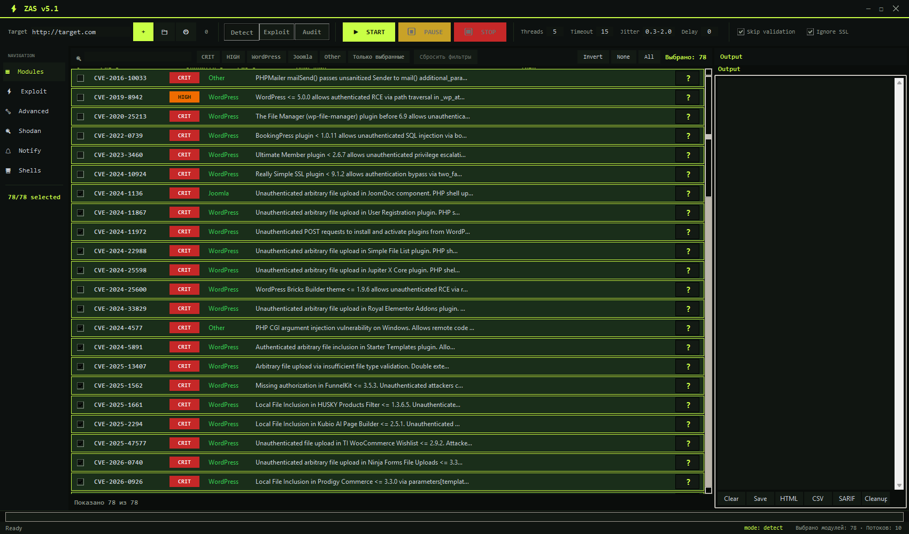

# ZAS v5.2

**ZAS** is a desktop application for **authorized** vulnerability research and exploitation (internal red team, lab ranges, engagements with written scope).

This package is the **runtime distribution**: GUI, exploit modules, and helper libraries.

> **Only test systems you are authorized to assess.** Unauthorized access is illegal.

> **This project is under active development.** See [Status and known limitations](#status-and-known-limitations) before relying on it — not everything here has been exercised against a live vulnerable target.



---

## Contents

```
ZAS/
├── zas_gui.py                 # Main GUI
├── zas_config.example.json    # Settings template (copy to zas_config.json)
├── requirements.txt           # Python dependencies
├── CHANGELOG.md               # Release history and known gaps
├── README.md
├── core/                      # Theme, export (TXT/JSON/CSV/HTML/SARIF/PDF), shells UI, audit log
├── exploits/                  # Exploit modules (WordPress / Joomla / other) + zas_core
└── lib/                       # Fingerprint, WAF, recon, creds, pivot, stealth, notifications,
                               # reverse-shell payloads and listener
```

**Included:** 85 modules (83 backed by a CVE, 2 post-exploitation helpers), shell session manager, reverse-shell listener and payload generator, reporting, optional advanced features (fingerprint, WAF, notifications).

Every exploit module is backed by a real, publicly disclosed PoC. See [CHANGELOG.md](CHANGELOG.md) for the source behind each one.

Langflow's twelve RCE chains are served by a single module,
`other_langflow_rce`, which reads the target version and runs only the
chains that apply to it. The per-CVE implementations live in `_lf_*`
siblings that the GUI loader skips.

---

## Requirements

| | |
|--|--|
| OS | Windows 10/11 (primary) |
| Python | **3.11 or newer** (with tkinter) |
| Network | Outbound HTTPS to targets you are allowed to test |

### Install

```bat
cd ZAS
python -m pip install -r requirements.txt
copy zas_config.example.json zas_config.json
```

If Python is not installed: [python.org](https://www.python.org/downloads/) → check **“Add Python to PATH”**.

---

## Start

```bat
python zas_gui.py
```

---

## Quick start

1. **Target** — type a URL and press **＋**, or **📁** to load a `.txt` list (one URL per line).
2. **Mode** — **Exploit** (the only mode).
3. **Modules** — search or filter (CRIT / HIGH / WordPress / Joomla / Other), tick modules in the table.
4. **Exploit panel** — credentials (`User` / `Pass`), command, shell token, payload, **custom headers**.
5. Optional: Threads / Timeout / Jitter / Delay, **Skip validation**, **Ignore SSL** (for lab / self-signed certs).
6. **▶ START** — progress in **Output** (right panel).
7. **Shells** — left menu; successful exploits open sessions (badge count appears there).
8. **Listener** — bind a port and generate a reverse-shell payload to run on the target.
9. Export from Output: **HTML / CSV / SARIF / PDF / Save**.

**Hotkeys:** `F5` start · `F6` pause · `F7` stop · `Ctrl+S` save log · `Ctrl+O` open targets.

---

## UI overview

| Zone | Purpose |
|------|---------|
| **Top bar** | Target, mode (Exploit), START / PAUSE / STOP, scan settings |
| **Left menu** | Modules, Exploit, Advanced, Shodan, Notify, Shells, **Listener** |
| **Main** | Module table (search, filters, severity badges, `?` details) |
| **Right** | Output log + export buttons |

---

## Notes

- **Exploit is the only mode.** Modules implement `info()` + `exploit()`; there is no passive detection stage.
- **A module only ships if a real public PoC backs it.** If a working chain cannot be derived from the public source, the module returns `ok=False` with a precise reason rather than inventing a request shape.
- **`ok=True` means execution was confirmed** — command output verified by marker. An HTTP status code alone is never treated as proof.
- **Custom headers** are applied to every request the tool makes. Set them per engagement; clear them afterwards, or one target's header will leak into the next scan.
- **`zas_config.json` and `reports/`** hold targets, credentials and shell tokens. They are gitignored — treat as sensitive.
- **Ignore SSL** is for lab targets with invalid certificates; leave it on only if you understand the risk.
- Cleanup button removes tracked shells/users/templates where possible.

---

## Tests

```bat
python -m pip install pytest coverage
python -m pytest tests -m "not slow"     # fast suite (~2 min)
python -m pytest tests                   # everything, incl. dead-host checks (~15 min)
python -m pytest tests --cov=exploits --cov=lib --cov=core
```

The slow suite asserts the honesty rule against every module at once: a dead
target must never produce `ok=True`. It is marked `slow` because each module
makes a network round trip.

Coverage of `lib/` and the shared helpers is high (80–96%). Coverage of the
individual exploit modules is low by nature — their `exploit()` bodies only
run against a live vulnerable target, which no test suite can fake. See
[Status and known limitations](#status-and-known-limitations).

---

## Status and known limitations

**This project is in active development.** The code is functional and the module collection is curated, but the following is either unverified, partial, or knowingly imperfect. Read it before a live engagement.

### Not tested against live vulnerable targets

Only two modules have been exercised end-to-end against a target that was actually vulnerable: `wp_ninja_forms_upload_rce` (CVE-2026-0740) and `other_nextjs_75604_rce` (CVE-2026-75604), both against mock targets. Everything else has been verified for **absence of false positives** — a dead host must never produce `ok=True` — but a green result here does **not** prove the chain works against a real deployment. Treat untested modules as unproven until you have run them in a lab.

### Modules that can never report success

Two modules always return `ok=False`, and that is deliberate:

- **`other_netscaler_preauth_rce`** (CVE-2026-88771) — no public PoC has a synchronous verification channel. The upstream waits up to 24 hours for an agent to connect and delivers via reverse shell. The module plants the stage and reports honestly; you must confirm out-of-band.
- **`other_langflow_93674_cmdinj`** (CVE-2026-93674) — blind command injection upstream. Same situation.

### Requires credentials or specific preconditions

Authenticated modules (`other_ghostcms_rce`, the five authenticated Langflow modules, `other_n8n_expr_rce`, `wp_funnelkit_plugin_install`) return `ok=False` naming the missing credential when none is supplied. Others need a specific configuration to be reachable at all — for example `wp_forminator_upload_rce` needs a published form with both an upload and a select field, `wp_blocksy_fonts_rce` needs Blocksy Pro plus two extensions, `wp_core_pagetemplate_lfi_rce` needs a theme with a top-level `page-*` directory. The module says which gate failed.

### Side effects on the target

Several modules do not undo what they did:

- `other_nable_ncentral_rce` leaves the servlet holder replaced until N-central restarts.
- `avideo_clone_rce` reads a DB dump and admin hashes; it does not clean up.
- `wp_dbbackup_fileread` is destructive by nature (gzip + unlink).

MSF's restoration steps were not ported for these. Plan for it on client systems.

### Reverse-shell listener has no authentication

The **Listener** panel binds a TCP port and accepts from anyone who connects. That is intentional for a shell catcher, but it means anything reaching that port gets an interactive channel to you. Bind to a specific host rather than `0.0.0.0` where possible, and stop it when not in use.

### Global custom headers

Custom headers set in the Exploit panel are applied to **every** session the tool creates. There is no per-target scoping yet. Clear the field between engagements.

### Environment constraints

- No SSH client is bundled; modules that would need one fall back to HTTP-only paths.
- Python dependencies are `requests`, `urllib3`, `aiohttp`, `reportlab`. Modules that need crypto (e.g. `other_nextjs_75604_rce`) carry their own pure-Python implementation.
- PDF export degrades to HTML if `reportlab` is missing.

### CVE attribution

All CVE IDs present were checked against NVD at the time of writing. Two modules carry CVEs from outside 2026 and say so: `other_struts_actionmapper_rce` is CVE-2013-2251, `other_vbulletin_adtemplate_rce` is CVE-2025-48827/48828. Some public PoCs predate their CVE assignment, so a module's CVE may be newer or older than the research it ports.

### Known incomplete modules

A handful of modules implement part of a real chain and say so in `info()`: `wp2shell_sqli` keeps the SQLi but not the RCE stage, `avideo_clone_rce` stops before RCE because the upstream needs a hostile clone server, `wp_travel_engine_deser` and `wp_wpforo_deser` confirm object injection but have no demonstrated RCE gadget chain. These return `ok=False` with the reason rather than claiming success.

---

## Troubleshooting

| Problem | What to try |
|---------|-------------|
| `python` not found | Reinstall Python and enable “Add to PATH” |
| `ModuleNotFoundError: requests` | `python -m pip install -r requirements.txt` |
| PDF export falls back to HTML | `python -m pip install reportlab` |
| Window won’t open / black screen | Update GPU drivers; try Python 3.11 x64 |
| Target never times out | Lower **Timeout**, enable **Skip validation** for bulk lists |
| SSL errors on HTTPS | Enable **Ignore SSL** (lab only) |
| Listener binds but no shell arrives | Check the host advertised in the payload is reachable from the target; a link-local or loopback address will never call back |

---

## Disclaimer

For defensive security testing, education, and **authorized** red-team use only. You are responsible for compliance with local law and engagement rules.

---

## Contact

**Telegram:** [@vaalzevul](https://t.me/vaalzevul)
